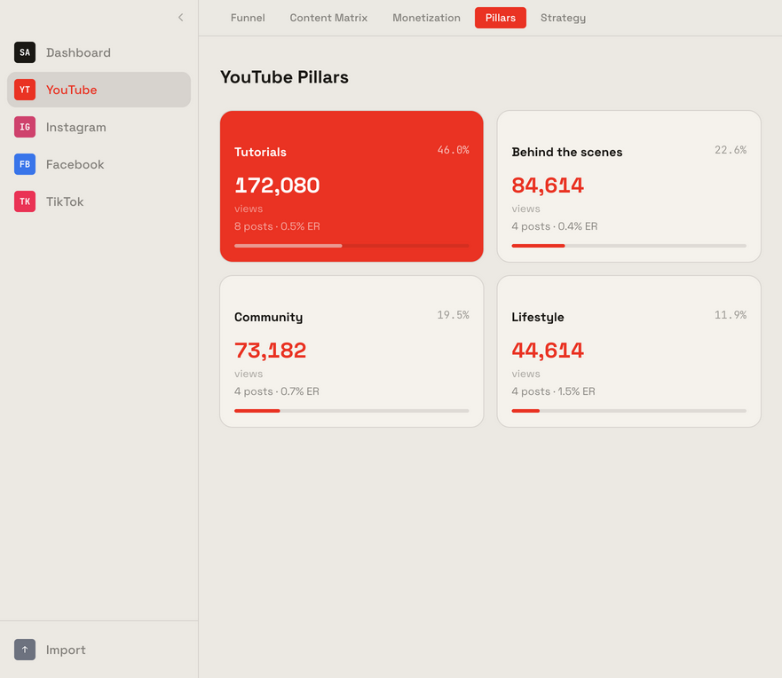
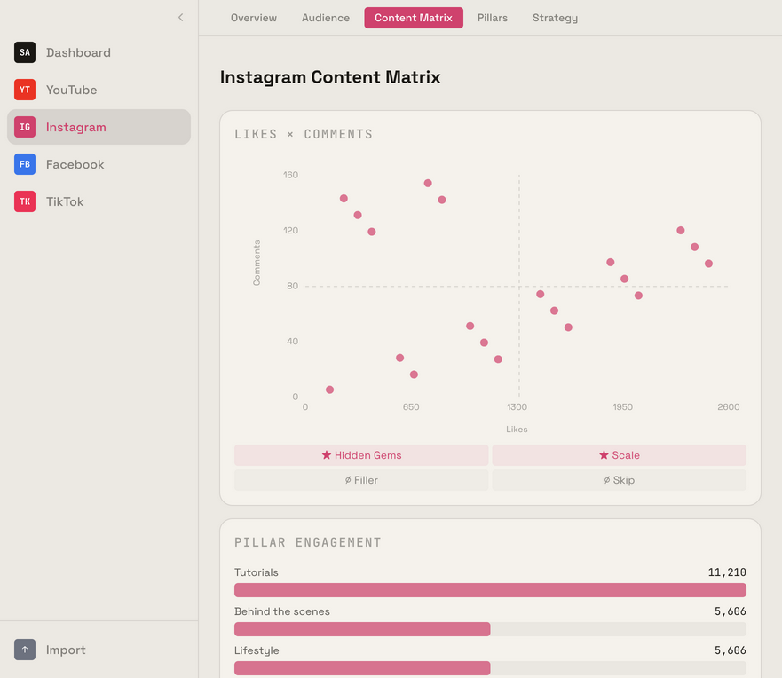
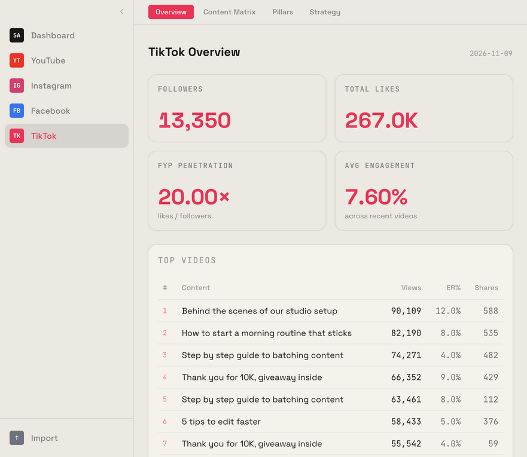
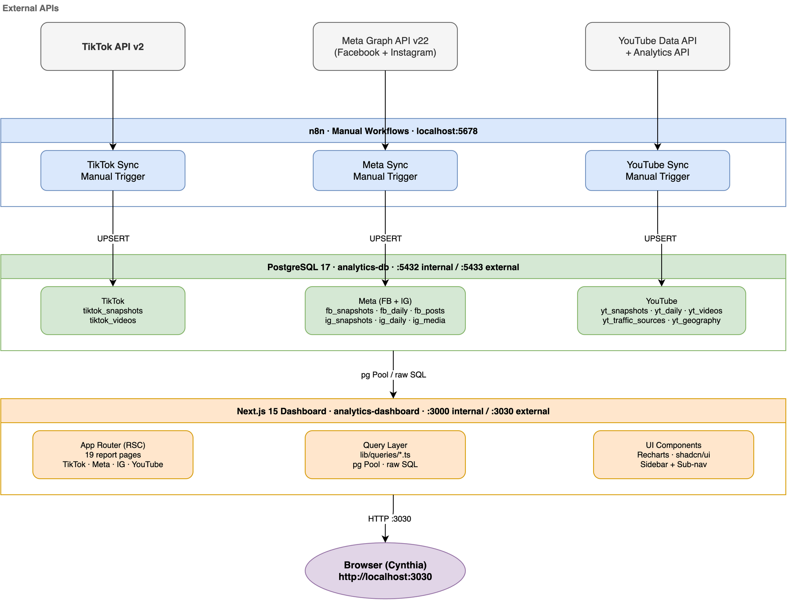

# Social Analytics Dashboard

A self-hosted dashboard for creators who post on **TikTok, Instagram, Facebook and YouTube**. It keeps your numbers in your own Postgres and shows, per platform:

- **Overview**: followers, reach and views over time
- **Matrix**: each post plotted by reach × engagement, so you can see what to repeat and what to drop
- **Pillars**: performance grouped by content category, using keyword rules you define
- **Audience / Funnel / Monetization**: platform-specific views (YouTube traffic sources, geography, revenue)
- **Strategy**: recommendation cards, read from the `strategy_content` table

Built with Next.js, Tailwind, Recharts and Postgres.

| YouTube pillars | Instagram matrix | TikTok overview |
|---|---|---|
|  |  |  |

<sub>Screenshots use the bundled demo data.</sub>



> The diagram also shows the optional n8n sync and AI strategy generator. They are not part of this repo yet (see [Roadmap](#roadmap)).

## Quickstart (Docker)

```bash
cp .env.example .env              # change POSTGRES_PASSWORD
docker compose up -d --build      # migrations run on container start
docker compose exec analytics-dashboard node migrate.js seed   # optional demo data
```

Open http://localhost:3030 (or your `APP_PORT`).

## Local development

```bash
npm ci
cp .env.example .env              # DATABASE_URL must point at a running Postgres
docker compose up -d analytics-db # or use your own Postgres
npm run migrate && npm run seed
npm run dev                       # http://localhost:3000
```

`npm run lint`, `npm run build` and `npm test` are what CI runs.

## Getting your data in

Go to **Import** in the sidebar and upload CSV exports. The file type is detected from its headers (see `lib/csv-mappings.ts`):

| Type | Must contain columns | Table(s) |
|---|---|---|
| TikTok Videos | `video_id`, `engagement_rate` | `tiktok_videos` |
| TikTok Snapshot | `metric`, `value` | `tiktok_snapshots` |
| YouTube Daily | `day`, `estimatedMinutesWatched` | `yt_daily` |
| YouTube Top Videos | `video`, `averageViewPercentage` | `yt_videos` |
| Instagram Media | `media_id`, `permalink` | `ig_media` |
| Instagram Daily | see `lib/csv-mappings.ts` | `ig_daily` |
| Meta Snapshot | `key`, `value` | `ig_snapshots`, `fb_snapshots` |
| Facebook Posts | `post_id`, `reactions` | `fb_posts` |

Imports are upserts, so re-importing the same file is safe. You can also write to the tables directly from any scheduler (cron, n8n, Airflow). The schema is in `migrations/`.

## Configuration

| Variable | Default | Purpose |
|---|---|---|
| `POSTGRES_PASSWORD` | `changeme` | DB password (both containers) |
| `DB_PORT` / `APP_PORT` | `5433` / `3030` | Host ports |
| `DATABASE_URL` | none | Used by `npm run dev/migrate/seed` outside Docker |
| `DASHBOARD_TITLE` | `Social Analytics` | Browser tab title (read at runtime) |
| `PILLARS_FILE` | `config/pillars.json` | Content-category keywords |

### Content pillars

Posts are put into categories by matching keywords in their title or caption. The first match wins, and anything unmatched is `Other`. Copy `config/pillars.example.json` to `config/pillars.json` (gitignored) and edit it:

```json
{
  "default": { "Tutorials": ["how to", "tutorial"], "Vlogs": ["vlog", "day in"] },
  "youtube": { "Long-form": ["full class", "masterclass"] }
}
```

A platform key (`tiktok`, `instagram`, `facebook`, `youtube`) replaces `default` for that platform.

## Roadmap

- Ship the n8n sync workflows (TikTok, Meta, YouTube APIs) as importable JSON
- Ship the AI strategy generator that fills `strategy_content`
- Instagram/Facebook demographics

## License

[MIT](LICENSE)
